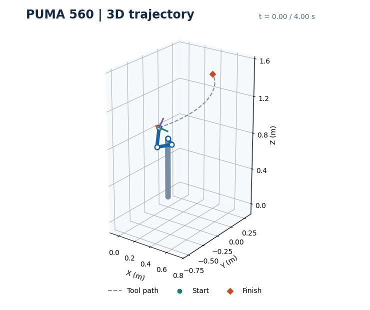
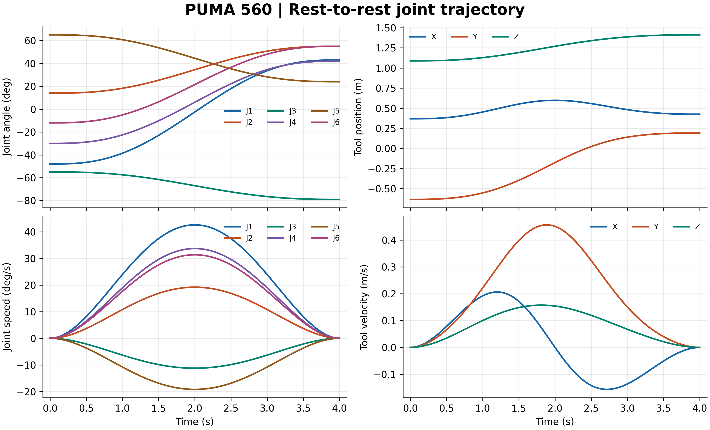
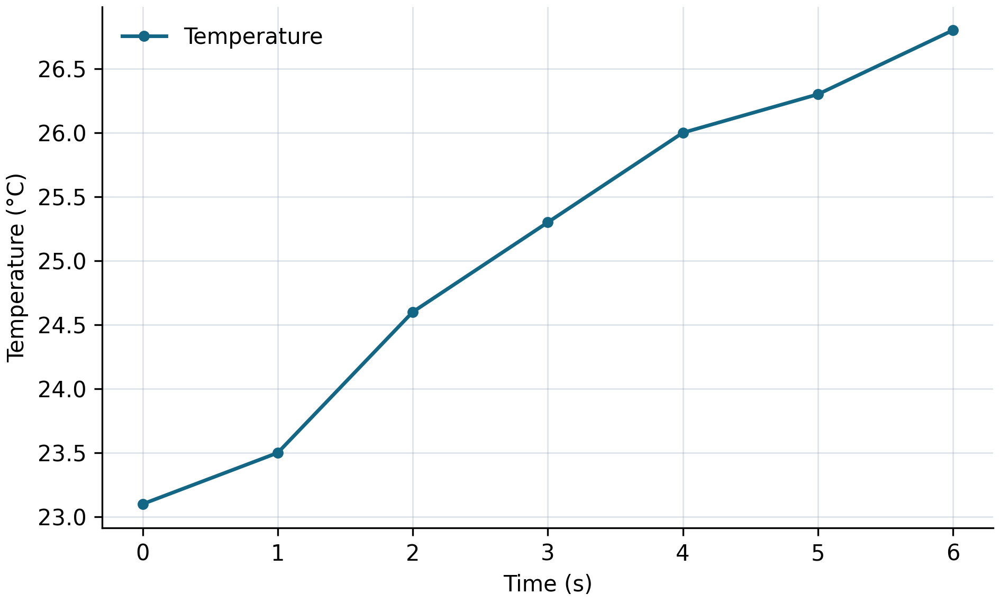
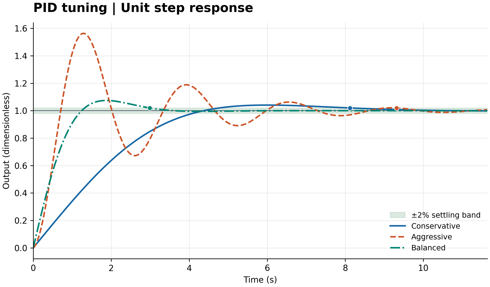

# Python 机器人工程作品集



三个独立的 Python 项目，分别演示机械臂运动学、实验数据出图和闭环控制。每个项目都有可运行的示例和从入口到核心计算的阅读指引。

| 作品 | 功能 | 入口与原理 |
|---|---|---|
| PUMA 560 机械臂 | 标准 DH、带限位的数值逆解、五次轨迹与 3D 动画 | [`demo.py`](robot_arm/demo.py) · [正逆解与收敛过程](robot_arm/README.md) |
| 实验数据出图 | CSV/Excel 批量清洗、300 dpi PNG 与矢量 PDF | [`plot_data.py`](data_plot/plot_data.py) · [输入格式、清洗规则和出图](data_plot/README.md) |
| PID 整定仿真 | 比较三组增益的单位阶跃响应、超调量和调节时间 | [`simulate_pid.py`](pid_sim/simulate_pid.py) · [闭环模型与指标](pid_sim/README.md) |

## 安装与运行

使用 64 位 CPython 3.10–3.14。以下命令在仓库根目录执行，Windows PowerShell 无需激活环境。

```powershell
python -m venv .venv
.\.venv\Scripts\python.exe -m pip install -r requirements.txt
.\.venv\Scripts\python.exe verify.py --output rerun
```

macOS 或 Linux 使用 `python3 -m venv .venv`，后两条的 Python 路径改为 `./.venv/bin/python`。安装时需要 Robotics Toolbox 等依赖为所用平台提供构建。完整验收逐个跑过 Windows x86-64 上的 Python 3.10、3.11、3.12、3.13 和 3.14。 [逐版本结果](results/compatibility.json) · [Robotics Toolbox 安装包](https://pypi.org/project/roboticstoolbox-python/1.5.0/#files)

`verify.py` 会跑三个命令行入口，检查数值阈值、故意构造的坏数据和输出文件。`--output` 接受新目录或空目录，省略时在临时目录验收。正常结束会显示 `All acceptance checks passed.`。 [验收脚本](verify.py) · [示例验收结果](results/acceptance.json)

## 示例曲线

**机械臂五次轨迹**覆盖 4 秒，图中给出六关节的位置、速度以及末端的 XYZ 位置和速度。起止点的速度与加速度为零。 [逐组运动学数据](results/robot_arm/validation.json)



**实验数据出图**展示从含缺值和重复行的合成 CSV 清洗出的温度曲线。 [矢量 PDF](results/data_plot/sensors_csv/01_temperature.pdf) · [清洗记录](results/data_plot/sensors_csv/cleaning.json)



**PID 阶跃响应**使用同一个二阶对象。图中阴影为 ±2% 调节带，圆点标出各组的调节时间。 [指标 CSV](results/pid_sim/metrics.csv)



## 许可证

项目自有代码与示例采用 MIT 许可证。第三方依赖遵循各自的许可证。 [LICENSE](LICENSE)
